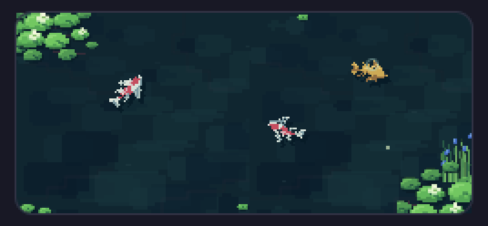
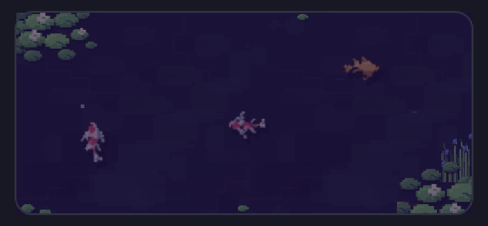
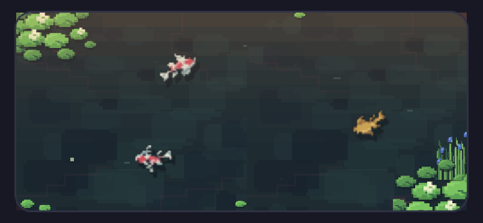
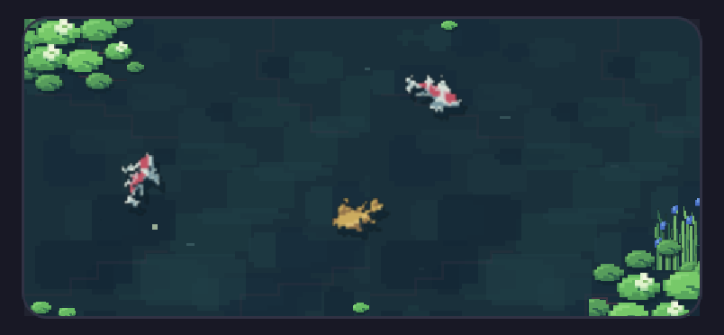
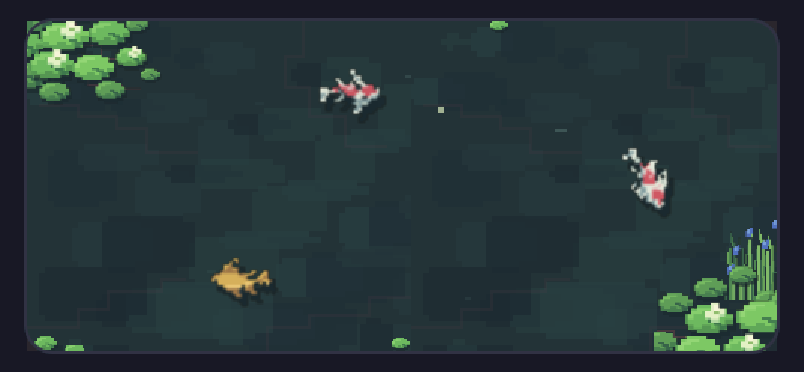
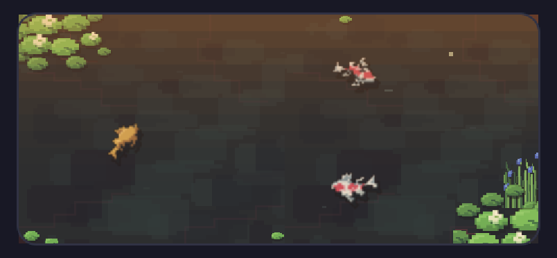

# Koi Pond

A mod for [Herdr](https://herdr.dev) that adds a small pixel-art koi pond under your agents list. The rest of your window stays as it is.



Three koi swim their own loops through dark teal water, under lily banks, reeds and floating pads. They drift deeper and back up, sip at the surface, and scatter when you click near them. The pond's light follows your computer's clock:

| Night | Sunrise | Day | Afternoon | Sunset |
| --- | --- | --- | --- | --- |
|  |  |  |  |  |

## Install

Ask your agent:

```
Read ~/.config/herdr-app/AGENTS.md, then add this mod and put it under my agents list: github.com/kwansing14/herdr-koi-pond
```

The pond needs a spot in a layout, so the agent adds a 124px `koi` block under the agents list of the layout you use. Herdr's own `main` is read-only: if that's yours, the agent clones it first and adds the pond to the clone.

Or by hand, starting from Herdr's `main`:

```sh
cp -R mods/koi ~/.config/herdr-app/mods/
herdr-app check ~/.config/herdr-app/mods/koi
herdr-app do layout.clone '{"name":"main","as":"main-koi"}'
```

Then, in `~/.config/herdr-app/layouts/main-koi.json`, replace the `agents` block with:

```json
{
  "id": "agents-area",
  "type": "column",
  "size": { "weight": 1 },
  "min": 190,
  "children": [
    { "id": "agents", "type": "block", "size": { "weight": 1 }, "min": 60, "content": { "mod": "agents" } },
    { "id": "koi-pond", "type": "block", "size": { "px": 124 }, "padding": [6, 8], "content": { "mod": "koi" } }
  ]
}
```

The window picks up the change within a second. Copy the mod folder rather than symlinking it: with a symlink the mod loads but every sprite renders blank. `ctrl-shift-l` cycles back to your other layouts, and deleting `mods/koi` and the clone removes the pond.

The `koi` mod runs no programs, reads no files outside its folder, keeps no state and opens no network connections.

## What's here

- `mods/koi/`: the pond mod, its SVG art and 448 pre-built koi sprites.
- `scripts/build-koi-sprites.py`: rebuilds `mods/koi/sprites/` and `mods/koi/sprites.js` from the `koi-*.svg` layers. Needs Python 3, Pillow and `rsvg-convert` (librsvg). Run `python3 scripts/build-koi-sprites.py`; it reports `448 sprites` when done.
- `previews/`: the pond at five times of day.
- `RECIPE.md`: the full brief another agent can rebuild the mod from.

## License

[MIT](LICENSE), covering the code, art and sprites.
