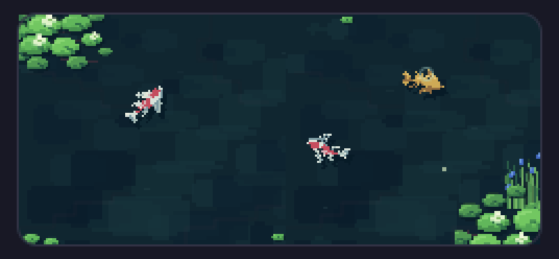

# Koi Pond

Herdr's stock window with a small pixel-art koi pond tucked under the agents list. Three koi swim their own loops through dark teal water, under lily banks, reeds and floating pads. They drift deeper and back up, sip at the surface, and scatter when you click near them.

**What you see:**

- **Everything outside the pond is Herdr's stock `main` layout:** the 268px sidebar with brand (46px), spaces, agents and footer (69px); the 42px tab bar; terminal panes; the hidden Files/Changes panel; and the 28px status bar.
- **The pond, 124px tall, sits at the bottom of the agents column.** It has 6px top/bottom and 8px side padding, so the water is 252×112. It has rounded corners (10px) and a 1px border in the theme's `border` color.
- **Water:** `#102630` in a dark theme, `#34565c` in a light one. It is covered by a pixel water texture tiled every 128px (full strength in dark, 65% in light).
- **Three koi** (pixel sprites, nearest-neighbour, each with a `#071b27` drop shadow 2px right and 3px down):
  - **kohaku:** white `#dee8df` with red `#cb4e60` patches; the largest, a 34px sprite.
  - **ogon:** solid gold `#d7b058` with `#997142` shading; a 30px sprite.
  - **sanke:** white with red and black `#27333e` patches; a 30px sprite.
  - **tancho** (white with one red crown spot, 26px) appears only when the pond is narrower than 120px (a folded sidebar), where it swims alone. It also joins as a fourth fish from 320px wide.
- **Banks:** a lily bank fills the top-left corner (50×35, top-left corner at −4, −7). A second bank fills the bottom-right (53×43, top-left corner at width−43, height−32). Reeds stand over it (27×35, top-left corner at width−21, height−49). Each spills past the pond's edge and is clipped.
- **Pads:** four small lily pads hug the edges. A 9px and an 8px pad sit bottom-left, a 7px pad sits at 48% of the width along the bottom, and a 7px pad peeks in from the top at 61%.
- **Glints:** six 1px-tall streaks (2–4px wide) in `#76a6a2` (light: `#afcfc0`), scattered across the surface.
- **Petal:** one 2×2 pale-green `#d4e8bd` speck at 70% opacity.
- **Layering:** water, then koi, then glints, banks, reeds and pads, then the petal, then ripples. Koi pass *under* the banks and pads.

**How it behaves:**

- **Agent statuses** (working, blocked, done, idle) look exactly as in the stock layout. The pond ignores agents.
- **Swimming:** each koi follows its own closed loop, one lap about every 32 seconds. Each fish has its own rhythm of speed bursts (kohaku 5 per lap, ogon 7, sanke 4, tancho 6) and a gentle sideways sway (±1.8px). It slows down in tight bends. Tancho swims its loop the other way.
- **Mood:** each koi switches between glide (full speed, 4–10s), coast (40%, 1.5–3.5s) and hover (5%, 1.2–3s). Speed eases about 70% of the way to the new mood each second. Below 60% speed the koi shows its coast animation: a slow, lazy tail.
  - Lazier fish hover and coast more: laziness is sanke 0.65, kohaku 0.4, tancho 0.35, ogon 0.2.
- **Facing:** the sprite points in one of 16 directions (22.5° apart). It turns toward the direction of travel at about 150°/s, faster for agile fish (ogon) and slower for calm ones (sanke). While turning, the body bends and the tail curves to the inside of the turn.
- **Depth:**
  - **Shallow:** opacity 92–100% for 8–22s.
  - **Deep:** 50–62% for 4–10s.
  - Each change crossfades over 2–4s.
- **Feeding:** every 8–15 seconds a shallow koi sips at the surface. A small 7px ring opens at its mouth and fades over 0.7s.
- **Ambient:**
  - **Glints:** pulse between 4% and 28% opacity, each on its own 4.9–6.9s cycle.
  - **Pads:** bob 1px over 7–9s.
  - **Petal:** wanders the pond, sliding between 12% and 86% of the width over 43s and between 16% and 72% of the height over 27s.
- **Click (left mouse button) in the pond:**
  - **Splash:** a 24px ring and, 160ms later, a 12px ring open from the point and fade over 0.95s. Ring color is `#b4e2d8` (light: `#f0fffa`).
  - **Startle:** every koi within about 28px of the click (27–33px depending on how jumpy it is) dives deep within 0.9s and stays deep 3–6s. It reacts after 0.1–0.6s: jumpy ogon first, sanke last, and later for fish further away.
  - **Flee:** the koi turns away from the click and darts about 15–30px (further when the click was closer, and further for jumpy fish) at 1.1–1.3× its cruising speed, with a quick tail.
  - **Return:** it pauses half a second, then swims back to the best spot on its loop and carries on gliding. Clicking a fleeing fish again sends it off again.
- **Resizing:** the loops scale to the pond's size. Below 120px wide, the banks, reeds, pads, glints and petal disappear and tancho swims a small central loop.
- **Theme:** switching between dark and light themes swaps the water, glint and ripple colors at once.
- No keys, no hover effects.

**Built from:**

- **Layout `layouts/koi.json`:** a copy of the stock `main` layout from Herdr 0.1.14, with the `agents` block wrapped in a column. The node tree:
  - Row `root` holds column `sidebar` (268px, `chrome`, not resizable) and column `work`.
  - Column `sidebar`:
    - Block `brand`.
    - Column `sidebar-lists`:
      - Block `spaces` (weight 1, min 90).
      - Column `agents-area` (weight 1, min 190): block `agents` (weight 1, min 60), then block `koi-pond` (124px, padding `[6, 8]`, mod `koi`).
    - Block `sidebar-footer`.
  - Column `work`:
    - Block `tabs`.
    - Row `work-body`: `main`, plus the hidden `panel` stack with `files` and `changes`.
    - Block `status`.
- **Shipped mods used:** `workspace-chrome` (header; footer with props `{ "footer": true }`), `spaces`, `agents`, `tabs`, `pane` (pane header), `files`, `changes`, `workspace-status`.
- **Mod `koi`:**
  - **Files:**
    - `mod.json` (`{"place":"none"}`).
    - `main.js`, a single `View`.
    - `sprites.js`, generated: `HEADINGS` and per-fish sprite `size` and `head` offset.
  - **API used:**
    - **`herdr`:** only `theme().border` and `settings().dark`.
    - **`gpui-kit`:** `div`, `image`, `.transition` (left, top, opacity, width, height), `.loop` (opacity, left, top), `.on_size_change`, `.on_mouse_down("left")`, `cx.timer.every` and `cx.timer.after`.
  - **What it doesn't do:** it runs no programs, reads no files, keeps no state and opens no network connections.
- **Motion:**
  - **Swim tick:** every 1000ms the script moves each koi to its next point on the loop, and a 1000ms linear `transition` on `left`/`top` carries it there natively.
  - **Facing tick:** every 100ms a cheap check turns the sprite and redraws only when the direction slot or the bend changes.
  - **Startle:** flees and returns run as short chains of `cx.timer.after` legs.
- **Loops:** a closed Catmull-Rom spline through route points (fractions of the pond), resampled by arc length plus 9px per radian of turning.
  - kohaku: `.18,.55 .29,.30 .52,.24 .76,.34 .83,.53 .65,.72 .40,.77 .20,.71`
  - ogon: `.23,.50 .37,.36 .59,.39 .77,.28 .85,.47 .70,.62 .47,.65 .27,.77 .16,.65`
  - sanke: `.20,.39 .40,.22 .65,.25 .80,.42 .72,.61 .52,.54 .35,.71 .18,.65`
  - tancho: `.28,.46 .43,.33 .66,.41 .77,.59 .59,.77 .37,.65`
  - narrow pond: `.42,.23 .65,.34 .64,.59 .54,.78 .35,.66 .34,.41`
- **Temperaments** (reactivity / agility / pace / laziness):
  - kohaku: .55 / .5 / 1 / .4
  - ogon: .9 / .8 / 1.1 / .2
  - sanke: .4 / .35 / .92 / .65
  - tancho: .7 / .65 / 1.05 / .35
- **Sprites:** `mods/koi/sprites/<fish>-<gait>[-left|-right]-<00..15>.gif`, 448 GIFs that `image()` plays natively.
  - Each has 20 frames: two tail beats and one pectoral-fin stroke.
  - Gaits: `cruise` at 76ms per frame, `brisk` (fleeing) at 60ms, `coast` at 118ms. `cruise` and `brisk` have left and right bend sheets.
  - The 16 headings are 22.5° apart, with 00 pointing right and 04 pointing down.
- **Sprite build:** `scripts/build-koi-sprites.py` (Python 3, Pillow, `rsvg-convert`).
  1. It stacks the white-filled layers `koi-body`, `koi-shade`, the marks (`koi-hi`, `koi-sumi`, `koi-tancho`), `koi-light` and `koi-eye`, recoloring each from `#fff`. It renders them at 52×34.
  2. It cuts out the two pectoral fins and rotates them about their roots.
  3. It shifts each pixel column to make the tail beat and the bend.
  4. It scales by fish (kohaku .88, ogon .76, sanke .8, tancho .66, all ×0.55) and rotates to 16 headings without smoothing. It adds the shadow and maps to a fixed 14-color palette (index 0 transparent; anything under 100/255 alpha becomes transparent).
  5. It crops every sheet of a fish to the smallest square around the same center, then writes the GIFs and `sprites.js`.
- **Art:** `water.svg` (texture), `lily-bank.svg`, `lily-bank-right.svg`, `reeds.svg`, `lily.svg` (pads), and the `koi-*.svg` fish layers. The fish layers are build inputs only and are not drawn at runtime.

**Watch out:**

- **Copy, don't symlink:** copy `mods/koi/` into `~/.config/herdr-app/mods/`. With a symlinked mod folder, the JS loads and `herdr-app check` passes, but every `image()` renders blank.
- **Files `check` writes:** `herdr-app check` writes `jsconfig.json` and `gpui-kit.d.ts` into the mod folder. They are gitignored here.
- **Animate natively:** don't animate with a faster timer. Every `cx.notify()` redraws the whole window. The pond redraws about 2.8 times a second when idle; all motion in between is native transitions, loops and GIF playback.
- **Preloading:** a GIF shows nothing until it has loaded, so the mod preloads the sprites it will need next. These are nearby headings (±2) for the current gait and its bends, plus coast, up to 16 a second; a startle queues the whole turn at once. Each one is rendered as an invisible 1×1 `image()` for 600ms. Without this, a koi blinks out for a frame on each turn.
- **Sprite centering:** sprites are positioned by their center, so each GIF canvas must stay centered on the fish. The crop keeps the center; an off-center crop makes koi jump when they turn.
- **Bend direction:** the `-right` sheets curve the tail to the fish's right, which is the inside of a clockwise turn on screen (y grows downward). Flip the sign and the tail flares outward, so the fish looks like it turns the other way.
- **Click targets:** clicks and the mouth of the feeding ring use where a koi is *drawn*, interpolated along its current move. They don't use the end of the move: a fleeing koi can be 60px away from that.
- **Size before first layout:** the pond assumes 252×112 until its first size report. On resize the loops are rebuilt and koi are placed at their current point without skipping ahead.
- **Size limits:** under 120px wide, only tancho and no decor; 120–319px, three koi; 320px and up, four.
- **Memory:** if every sheet of every fish gets loaded, the decoded frames take about 33 MB.
- **Stock layout copy:** the layout is a snapshot of `main` from Herdr 0.1.14. Later changes to Herdr's own `main` layout won't appear in it.
- **Rebuilding sprites:** rebuilding overwrites `mods/koi/sprites/` and `sprites.js`. With the same Pillow and librsvg versions, a rebuild with unchanged inputs produces identical files; other versions may shift antialiased edge pixels.

**Done when:**

Herdr must be the front window: `herdr-app shot` returns the last frame drawn, which goes stale while Herdr is behind another app.

- `herdr-app check ~/.config/herdr-app/mods/koi` passes, and `herdr-app status` shows no errors after `layout.switch {"name":"koi"}`.
- A 252×112 pond with a rounded border sits under the agents list. Kohaku, ogon and sanke swim continuously, pass under the banks and pads, and never leave the water.
- A turning koi bends its tail toward the inside of the turn, and no koi blinks out while turning.
- Every 8–15 seconds a small ring opens at a shallow koi's mouth.
- Clicking just beside a koi shows two splash rings. The koi fades deeper, darts away within about half a second, and is back on its loop within a few seconds.
- Folding the sidebar leaves only tancho in a plain narrow pond; unfolding brings back the three koi and the decor.
- Switching to a light theme lightens the water to `#34565c`.
- `python3 scripts/build-koi-sprites.py` reports `448 sprites`, and the koi still look and swim the same afterwards.
